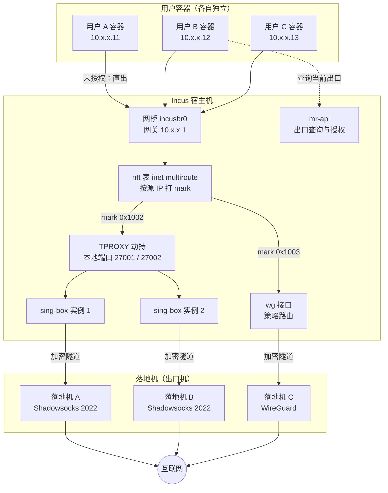
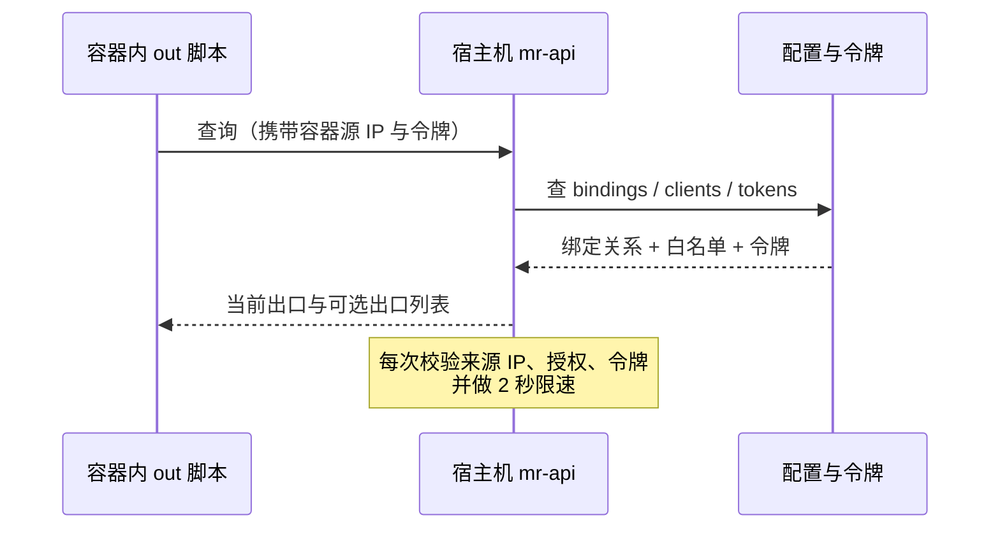

# Incus MultiRoute

**给 Incus（LXC）宿主机用的多出口管理脚本。** 让每个容器从不同的落地 IP 出网，全部操作在菜单里完成。

## 一键安装

在 **Incus 宿主机**上以 root 执行：

```bash
curl -fsSL https://raw.githubusercontent.com/CinnieMochi/incus-multiroute/main/install.sh | bash
```

装完输入下面的命令打开菜单：

```bash
mr
```

> 连不上 GitHub 时看 [安装与升级](#六安装与升级) 的离线安装方法。

### 它是什么

| 项目 | 内容 |
|---|---|
| 运行位置 | Incus 宿主机（入口机），不是容器里 |
| 作用 | 给每个容器绑定独立出口，容器零配置透明出网 |
| 支持协议 | **Shadowsocks**、**Shadowsocks 2022**（TCP + UDP 全代理）、**WireGuard**（全协议） |
| 操作方式 | 全交互式菜单，不需要记命令 |
| 隔离性 | 只维护自己的一张 nft 表，不碰 incus 与其它面板的规则 |
| 当前版本 | **v2.5.2** |

---

## 目录

1. 它长什么样（架构图）
2. 这套东西在解决什么问题
3. 名词解释
4. 工作原理（数据面 / 控制面）
5. 使用前提
6. 安装与升级
7. 第一次配置：从零到能用
8. 菜单逐项详解
9. 落地机怎么搭
10. 用户看到的是什么
11. 透明代理（TPROXY）深入说明
12. 重启后会发生什么
13. 排错手册
14. 安全说明
15. 常见问题
16. 附录：文件与单元清单
17. 版本历史

---

## 一、它长什么样（架构图）

### 1. 整体链路（Mermaid，GitHub 会渲染成图）



### 2. 同一张图（纯文本版，任何环境都能看）

```
   用户 A 容器        用户 B 容器        用户 C 容器
   10.x.x.11          10.x.x.12          10.x.x.13
        │                  │                  │
        └──────────────────┼──────────────────┘
                           │
                  ┌────────▼─────────┐
                  │  网桥 incusbr0    │  网关 10.x.x.1
                  └────────┬─────────┘
                           │
                  ┌────────▼──────────────────────┐
                  │ nft 表 inet multiroute         │
                  │  ① 私网目标 → 直接放行（旁路）   │
                  │  ② 按源 IP 打 mark             │
                  │  ③ 有 mark → TPROXY 劫持        │
                  └────────┬──────────────────────┘
                           │
        ┌──────────────────┼───────────────────┐
        │                  │                   │
   ┌────▼─────┐      ┌─────▼────┐       ┌──────▼─────┐
   │sing-box 1│      │sing-box 2│       │  wg 接口    │
   │  :27001  │      │  :27002  │       │  策略路由   │
   └────┬─────┘      └─────┬────┘       └──────┬─────┘
        │                  │                   │
   ┌────▼─────┐      ┌─────▼────┐       ┌──────▼─────┐
   │ 落地机 A  │      │ 落地机 B  │       │  落地机 C   │
   │ ss2022   │      │ ss2022   │       │ WireGuard  │
   └────┬─────┘      └─────┬────┘       └──────┬─────┘
        └──────────────────┼───────────────────┘
                           ▼
                        互联网
```

### 3. 一次请求的完整路径

以"用户 B 的容器访问一个网站"为例：

```
① 容器发出 TCP 连接：源 10.x.x.12:54321 → 目标 198.51.100.20:443
② 包进入网桥 incusbr0
③ nft 查表：源 IP 10.x.x.12 有绑定 → 打上 mark 0x1002
④ nft 继续：该 mark 对应出口 B → TPROXY 劫持到本机 27002
⑤ sing-box 2 接管这条连接，读出原始目标 198.51.100.20:443
⑥ sing-box 用 Shadowsocks 2022 加密，发往落地机 B:8388
⑦ 落地机 B 解密后代替你访问 198.51.100.20
⑧ 回包沿原路返回：落地机 → sing-box → 容器
```

### 4. 授权链路（用户端 out 脚本）



**只有"已绑定 + 已授权 + 令牌正确"三件事都满足，容器才能拿到出口信息。** 未授权的容器即使知道 API 地址也查不到任何东西。

---

## 二、这套东西在解决什么问题

一台 Incus 宿主机上跑着几十个用户容器。默认情况下，所有容器都从**同一个 IP** 出网。这会带来三个问题：

| 问题 | 后果 |
|---|---|
| 出口 IP 被共用 | 一个用户被网站封，所有人都被封 |
| 无法按用户分配线路 | 不同地区的用户抢同一条线路 |
| 出问题无法定位 | 不知道是哪个用户在用流量 |

这个脚本做的事：**给每个容器绑定一个独立出口**，容器里不用装任何客户端、不用改任何配置，出网就自动走指定的落地机。

---

## 三、名词解释

| 名词 | 含义 |
|---|---|
| **入口机** | 你现在这台 Incus 宿主机，用户容器都跑在上面 |
| **落地机** | 真正帮你访问互联网的那台机器，需要跑 Shadowsocks 或 WireGuard 服务端 |
| **出口** | 一条"从入口机到落地机"的线路配置，一条出口 = 一个落地机 |
| **mark** | 给数据包打的一个数字标记，用来区分"这个包属于哪个出口"，范围 0x1000-0x1fff |
| **TPROXY** | Linux 内核的透明代理机制，能在不改客户端配置的前提下把包"劫持"给本地代理程序 |
| **sing-box** | 我们的代理客户端，装在入口机上，负责把容器流量加密后发给落地机 |
| **bindings** | 记录"哪个容器的哪个 IP 绑定到哪个出口"的配置文件 |
| **旁路** | 发往私网地址（内网互联、DNS 等）的流量不走出口，直接放行 |


---

## 四、工作原理

分三层看，比混在一起好理解。

### 1. 数据面：包怎么被送进出口

```
容器 → 网桥 → nft 打 mark → TPROXY 劫持 → sing-box → 落地机 → 互联网
```

关键点：

- **按源 IP 识别用户**：nft 里有一张映射表，容器 IP → mark
- **按 mark 识别出口**：mark → 本地端口（27001、27002…每个出口一个）
- **私网目标旁路**：10/8、127/8、169.254/16、172.16/12、192.168/16 直接放行，不劫持
- **TCP 和 UDP 都劫持**：这是 v2.0.0 之后的能力
- **sing-box 的监听端口被保护**：来自非网桥、非 lo 的访问会被丢弃，不会暴露到公网

### 2. 控制面：配置怎么生效

```
菜单操作 → /etc/incus-multiroute/*.conf → 重新生成 nft 与 sing-box 配置 → 下发
```

- 每次改动都**完整重新生成**规则文件，不做增量修改，避免历史残留
- 生成后先用 nft -c 校验语法，**校验不通过就保留现有规则不动**（防止把网络搞断）
- 开机由 mr-restore.service 自动重新下发一次

### 3. 用户面：容器怎么知道自己的出口

容器里有一个 out 脚本，通过宿主机的 API 查询：

```
容器 → http://网桥网关:端口 → mr-api → 返回当前出口名称
```

API 会校验三件事：**来源 IP 是否绑定**、**是否在授权白名单**、**令牌是否正确**，并做 2 秒限速。

---

## 五、使用前提

| 项目 | 要求 |
|---|---|
| 系统 | Ubuntu / Debian（其它发行版未验证） |
| Incus | 已在用，网桥模式（默认 incusbr0） |
| 依赖 | nftables、python3、curl、jq、wireguard-tools、sing-box（都在菜单里一键装） |
| 权限 | root |
| 落地机 | 至少一台，跑 Shadowsocks 或 WireGuard 服务端 |

**不需要**：不需要改容器的网络配置，不需要在容器里装客户端，不需要动 incus 的 profile。

---

## 六、安装与升级

### 1. 在线安装（推荐）

```bash
curl -fsSL https://raw.githubusercontent.com/CinnieMochi/incus-multiroute/main/install.sh | bash
```

装完输入 mr 打开菜单。

安装脚本会做这些事：

| 步骤 | 说明 |
|---|---|
| 下载脚本 | 优先按 commit SHA 从 codeload 拉取，避免 CDN 缓存拿到旧版本；失败则回退 raw |
| 安装主脚本 | 复制到 /usr/local/bin/mr 并加执行权限 |
| 安装 API | 复制到 /usr/local/bin/mr-api.py |
| 装 API 服务 | 创建并启用 mr-api.service，立刻启动 |
| 配置用户端 | 把 client/out 里的默认 API 地址改写成本机网桥网关，再放入基准目录 |
| 改写容器侧地址 | 后续推送到容器的 out 会自动指向本机网桥网关 |

安全提示：安装脚本只写 /usr/local/bin 与 /etc、/var/lib 下自己的目录，不会 flush 任何 nft 表、不会重启 incus。

### 2. 离线安装

服务器连不上 GitHub 时：

1. 在一台能上网的机器上把仓库下载下来
2. 把 **install.sh、mr.sh、mr-api.py、version.txt、client/out** 放到服务器上同一个目录
3. 在该目录执行：

```bash
bash install.sh
```

脚本检测到本地有 mr.sh 就会走离线模式，全程不联网。

### 3. 升级

| 方式 | 操作 |
|---|---|
| 菜单升级 | 输入 mr → 菜单 15，检查并更新。会自动备份旧版本为 mr.bak.版本号 |
| 重新安装 | 再跑一次上面的在线安装命令，会覆盖为新版本，配置不动 |

升级**不会**清空出口与绑定，也不会重启 incus。

### 4. 卸载

菜单 99，需要输入两次 yes。详见第八节「99 一键卸载」。

---

## 七、第一次配置：从零到能用

### 步骤 1：装依赖（菜单 14）

```
[14] 依赖安装（分类选择）
   [1] 基础套件        nftables / iproute2 / curl / jq / python3
   [2] 隧道组件 · wg   wireguard-tools（只用 ss 出口可不装）
   [3] 隧道组件 · ss   sing-box（用 ss / ss2022 出口必须装）
   [4] 全部安装
```

只打算用 Shadowsocks 出口，按 14 → 3 就够。

### 步骤 2：加一条出口（菜单 2）

```
[2] 新增出口
   [1] ss2022
   [2] ss
   [3] wg

   加密方式（Shadowsocks 2022）：
     [1] 2022-blake3-aes-128-gcm
     [2] 2022-blake3-aes-256-gcm
     [3] 2022-blake3-chacha20-poly1305
     [0] 返回上一级

   服务器地址: 203.0.113.5
   端口 [2525]: 8388
   密码: ********
   期望出口 IP（留空用服务器地址）: 203.0.113.5
```

**添加成功后会立刻自动下发规则**，sing-box 当场启动，菜单顶部的"运行中 N 个出口"立即变化，不用再手动按 10。

### 步骤 3：创建容器

用你平时的方式创建容器即可，例如：

```bash
incus launch 镜像名 容器名 -n incusbr0
```

这一步不归本脚本管。

### 步骤 4：把容器绑定到出口（菜单 6）

```
[6] 绑定容器到出口 → 先选出口，再选容器
```

绑定完成后，这个容器的流量会立刻走对应出口。

### 步骤 5：授权用户（菜单 9 → 2）

授权 = 允许这个容器查询出口信息并拿到 out 脚本。

### 步骤 6：用户容器里验证

```bash
out current                    # 看当前出口
curl -s https://api.ipify.org  # 看实际出口 IP
```

---

## 八、菜单逐项详解

### 主菜单

```
[1] 出口节点（启用开关）
[2] 新增出口
[3] 删除出口
[4] 出口连通性测试
[5] 容器列表
[6] 绑定容器到出口
[7] 解除容器绑定
[8] 按 incus 实际状态校正
[9] 用户端 out 管理
[10] 重新下发全部规则
[11] 环境体检
[12] API 服务管理
[13] 安装本脚本到系统
[14] 依赖安装（分类选择）
[15] 检查并更新脚本（GitHub）
[16] 安全加固（源 IP 防伪）
[99] 一键卸载
[0] 退出
```

### 1 出口节点（启用开关）

列出所有出口，**输入编号**可以把这个出口在"启用 / 停用"之间切换。

停用后：该出口的 sing-box 服务停止；绑定它的容器**回落到入口机直出**；用户端 out list 里看不到这个出口。

> 临时维护出口请用这个开关，**不要直接删出口**——删了绑定会一起没。

### 2 新增出口

| 协议 | 适用 | 说明 |
|---|---|---|
| ss2022 | 强烈推荐 | 加密更强，需要 16 或 32 字节 base64 密码 |
| ss | 兼容老服务端 | 经典 AEAD 加密 |
| wg | 需要 UDP 全通 / ICMP | WireGuard，全协议隧道 |

**地址栏支持** IPv4、IPv6 字面量、域名。填 IPv6 时会提醒：宿主机必须已有 IPv6 出网。

### 3 删除出口

按编号删除，会自动停止并删除对应 sing-box 单元、清理配置、解除所有绑定到它的容器（这些容器回落到直出）。

### 4 出口连通性测试

检查每个出口的 sing-box 进程是否在跑、本地端口是否在监听。

**注意**：这是"本地就绪检查"，ss 协议没法从宿主机直接测出"落地机能不能通"。端到端验证要在容器里做。

### 5 容器列表

列出所有容器及其 IP、绑定情况，用来确认容器 IP 没变。

### 6 / 7 绑定 / 解除绑定

- 绑定：选出口 → 选容器 → 立刻生效
- 解除：选容器 → 该容器回落到入口机直出

> 解除绑定**不会删除**记录，只清空出口字段。这是为了防止把自己锁在外面。

### 8 按 incus 实际状态校正

容器重建后 IP 会变，nft 里的映射就失效。这个功能会重新扫描 incus，把 bindings.conf 里的 IP 更新成实际值并重新下发。

建议配合 9 → 7 的自动校验定时器一起用。

### 9 用户端 out 管理

```
[1] 查看授权与同步状态
[2] 授权并下发（单个用户）
[3] 撤销授权并回收（单个用户）
[4] 全部授权并下发（所有容器）
[5] 全部撤销授权并回收
[6] 校验并修复（仅已授权用户）
[7] 开启自动校验（自定义间隔，最小 5 分钟）
[8] 关闭自动校验
[9] 更新基准脚本（从指定路径）
[10] 新容器自动授权：已开启 / 未开启
```

#### 授权与下发的关系

| 概念 | 说明 |
|---|---|
| 授权 | 允许这个容器查询出口、并被推送 out（记录在 clients.conf） |
| 绑定 | 决定这个容器的流量走哪个出口（记录在 bindings.conf） |
| 下发 | 把 out 脚本写进容器 /usr/local/bin/out |

三者独立：授权了但没绑定，容器能看到出口列表但没有出口可走；绑定了但没授权，容器能走出口但查不到信息、也拿不到 out。

#### [1] 状态表怎么看

```
  容器               IPv4             授权 状态
  user-a-01            10.10.2.11       是 一致
  user-b-02            10.10.1.22       否 未下发
```

- 列出**所有正在运行**的容器（已停机的容器没有 IPv4，不在表内）
- `一致` = 容器里的 out 与宿主机基准哈希相同；`版本不一致` = 需要 [6] 校验并修复；`缺失` = 容器里没有 out
- 表格末尾会汇总“共 N 个容器，其中 M 个已授权”

#### [7] 自动校验到底做什么

开启后会创建一个 systemd 定时器 `mr-sync.timer`，按你指定的间隔（最小 5 分钟）执行：

```
mr sync  →  只遍历「已授权」的容器
            逐个比对容器里 out 的 sha256 与宿主机基准
            不一致才推送，一致则什么都不做
            结果写入 /var/lib/incus-multiroute/sync.log（仅有变化或失败时记录）
```

**它不会做的事（重要）**：

| 场景 | 自动校验会处理吗 |
|---|---|
| 已授权容器里的 out 被用户删了/改坏了 | ✅ 会重新推回去 |
| 你更新了基准脚本（[9] 更新基准） | ✅ 下一次触发时全量同步 |
| **新建的容器** | ❌ **不会**——新容器默认未授权，永远不会被下发 |
| **容器重建（同名新 IP）** | ⚠️ out 会推送，但**绑定关系里的 IP 是旧的**，出口会不生效，需要 [8] 校正 |
| 容器停机 | 跳过（不影响其它容器） |
| 授权表里有已删除的容器 | 跳过并在输出里提示（可用 [3] 撤销） |

所以新用户的正确流程是：**建容器 → [6] 绑定出口 → [9]→[2] 授权并下发**。授权那一刻就已经把 out 推下去了，不需要等定时器。

#### [10] 新容器自动授权（让新容器开箱即用）

开启后，定时器每次运行（默认每 10 分钟，可设 5 分钟起）会：

```
扫描所有「运行中」的容器
  ├─ 已在授权表里 → 跳过
  ├─ 在拒绝名单里 → 跳过（管理员撤销过的不会被偷偷加回来）
  └─ 其它        → 自动授权 + 建立身份记录 + 推送 out
```

效果：**用户新建的容器，最多等一个周期就能直接输入 out 切换出口**，不用管理员手动授权。

| 行为 | 说明 |
|---|---|
| 触发时机 | 定时器每次运行；也可手动 [6] 或 mr sync |
| 只处理运行中的容器 | 停机的推不进去，等它起来下一轮再纳管 |
| 管理员撤销过的不再自动加回 | [3] 撤销会把容器写进 clients.deny |
| 自动建立身份记录 | 新容器默认是"入口机直出"，用户自己 out use 切到出口 |
| 可随时关闭 | [10] 再按一次即可，已授权的容器保持不变 |

开启 [7] 时会顺带问一句"是否自动授权新容器"，选是就一并打开。

### 10 重新下发全部规则

重新生成 nft 表 + 重启所有 sing-box 单元。**任何"改了但没生效"的情况，按这个。**

### 11 环境体检

分三档：OK / 提示 / 注意或 FAIL。检查项包括 incus、nftables、python3、sing-box、wireguard-tools、ip_forward、rp_filter、nft 表、基准脚本与哈希、br_netfilter、tproxy 策略路由、定时器、出口 mark 唯一性、外部 fwmark 冲突、容器源 IP 防伪、宿主机 IPv6 提示。

### 12 API 服务管理

查看 API 状态、重启、查看监听地址。

### 13 安装本脚本到系统

把当前运行的脚本复制到 /usr/local/bin/mr，之后直接输入 mr 即可。

### 14 依赖安装

分类安装，见步骤 1。14 → 4 是一次装齐。

### 15 检查并更新脚本

从 GitHub 拉版本号比对。更新前会备份当前脚本为 mr.bak.版本号。

### 16 安全加固（源 IP 防伪）

```
[1] 查看各容器加固状态
[2] 全部开启（按宿主机协议族自动选择）
[3] 指定容器开启
[4] 指定容器关闭
```

**加固的是什么**：Incus 的 `security.ipv4_filtering` 与 `security.ipv6_filtering`，
会在容器网卡上做一层过滤——**只允许容器用自己分配到的 IP 发包**，改了源 IP 的包直接丢。

**为什么需要**：

| 没有加固时能做的事 | 后果 |
|---|---|
| 伪造源 IP 打 UDP 反射（DNS、QUIC） | 受害者承受放大流量，你的 IP 被投诉甚至拉黑 |
| 冒名发包 | 日志全指向被冒名的容器，追责追错人 |
| 伪造未绑定 IP | 绕过将来可能加的"按 IP 限制"策略 |

**按宿主机协议族自动选择**：

| 宿主机情况 | 脚本行为 |
|---|---|
| 只有 IPv4 | 只设 `security.ipv4_filtering`，IPv6 那项跳过并说明原因 |
| 只有 IPv6 | 只设 `security.ipv6_filtering` |
| 两者都有 | 两个都设 |
| 都没有（异常） | 拒绝执行 |

**注意**：加固只防"伪造源 IP"，不防容器之间互相访问。两者是不同的问题。

**回退**：用 `[4] 指定容器关闭`，或直接 `incus config device unset <容器> <网卡> security.ipv4_filtering`。

### 99 一键卸载

**两次确认**才会执行。卸载会：

- 停止 mr-api、mr-restore、mr-sync.timer、所有 mr-ss-*
- 删除 wg 接口与策略路由
- 删除 inet multiroute 表
- **把 br_netfilter 恢复为 1**
- 回收所有已授权容器里的 out
- 删除 /etc/incus-multiroute、/var/lib/incus-multiroute、/usr/local/bin/mr、mr-api.py

**不会删**：incus 本体、任何容器、其它面板的 nft 表、端口映射。

最后会问一句"是否一并卸载依赖组件 wireguard-tools / sing-box"，输入 yes 才删，直接回车保留。


---

## 九、落地机怎么搭

### Shadowsocks 2022（推荐）

落地机装 shadowsocks-rust 或 sing-box 服务端，生成一个 2022-blake3 系列密码：

```bash
# 生成 16 字节 base64 密码（对应 aes-128-gcm）
openssl rand -base64 16
```

然后按服务端软件的方式起服务，记下四项：**地址、端口、加密方式、密码**，填进入口机的菜单 2 即可。

### 经典 Shadowsocks

同上，加密方式选 2022 之外的（aes-256-gcm 等），密码是普通字符串。

### WireGuard

落地机需要：

1. 生成密钥对
2. 起 wg 接口（监听一个 UDP 端口）
3. 开启转发：net.ipv4.ip_forward=1
4. **做 NAT**，否则出去的包源地址是隧道内网段，会被丢弃：

```bash
iptables -t nat -A POSTROUTING -o eth0 -j MASQUERADE
```

入口机这边在 2 → 3 填：地址、端口、落地机公钥、本机隧道地址。

---

## 十、用户看到的是什么

用户容器里只需要一个 out：

```bash
out list        # 列出可用出口
out current     # 当前出口
out test        # 连通性测试
```

普通用户全程不需要知道落地机地址、密码、端口，只需要知道"我现在走哪个出口"。

用户端脚本里**不含任何落地机信息**，只包含宿主机 API 地址。

---

## 十一、透明代理（TPROXY）深入说明

> 这一节讲 ss / ss2022 出口的底层机制，只用 wg 出口可以不看。

### 1. 为什么用 TPROXY

| 方案 | TCP | UDP | 说明 |
|---|---|---|---|
| REDIRECT | 支持 | 不支持 | 内核 nat 只支持 TCP 透明重定向 |
| **TPROXY** | 支持 | 支持 | 本项目采用 |
| TUN | 支持 | 支持 | 多一张网卡，性能略低 |

选 TPROXY 的原因：**性能最好、不多加网卡**，代价是需要关一个内核参数。

### 2. 它依赖的内核参数

```
net.bridge.bridge-nf-call-iptables = 0
```

**为什么必须关**：开启时，桥接进来的包会在 netfilter 里被处理两遍，TPROXY 的套接字投递会失效——现象是"规则命中、路由也对，但代理程序收不到任何连接"。

脚本在新增第一个 ss 出口时会自动写入 /etc/sysctl.d/90-incus-multiroute.conf 并立即生效。

### 3. 关掉它的影响（实测结论）

| 路径 | 是否受影响 |
|---|---|
| 容器 → 外网 | 不受影响（forward 计数照常增长） |
| 容器 → 宿主（API、SSH） | 不受影响（input 计数照常增长） |
| 端口映射 DNAT / SNAT | 不受影响 |
| **容器 ↔ 容器（同网桥）** | **不再经过防火墙** |

唯一的损失是"容器间二层流量不再被过滤"。

如果现在压根没有容器间过滤规则（可用 nft list ruleset 查 iifname 与 oifname 同时为网桥的规则，通常是 0 条），那关掉它对现有功能没有任何影响。

将来要补容器间隔离，用 table bridge 家族的规则即可，不必把参数开回来。

### 4. 自动恢复

| 操作 | br_netfilter |
|---|---|
| 新增 ss 出口 | → 0 |
| 停用所有 ss 出口 | → 1（自动） |
| 一键卸载 | → 1（自动） |

### 5. 每个出口占一个本地端口

**是的，每增加一个 ss / ss2022 出口，就会多占一个本地端口。**

```
第 1 个 ss 出口 → 网桥IP:27001
第 2 个 ss 出口 → 网桥IP:27002
...
第 N 个 ss 出口 → 网桥IP:(27000 + N)
```

| 项目 | 说明 |
|---|---|
| 端口段 | 27000-27099（`mr.conf` 里的 TPROXY_BASE 可改） |
| 上限 | **99 个 ss 出口**；超出会被拒绝并提示 |
| wg 出口 | **不占端口**（走三层路由，不用 tproxy） |
| 停用的出口 | 释放端口，但编号仍保留（重新启用回到原端口） |
| 每个出口的资源 | 一个 sing-box 进程，实测约 **57 MB** 内存 |

所以开 99 个出口大约需要 5.6 GB 内存，实际部署时按机器资源规划，通常几个到十几个出口就够。

端口号是按出口在配置里的**先后顺序**分配的，删除中间的出口会让后面的端口号前移（规则会一起重新生成，不会错位，但那一刻该出口的连接会断一下）。

### 6. 端口安全与端口占用

sing-box 的 tproxy 入站**只监听网桥地址**（例如 10.x.x.1）的 27000-27099 段，每个出口一个端口。
nft 的 tproxy 规则也明确指向这个地址（`tproxy ip to 网桥IP:端口`），所以：

- 代理端口**不会暴露到公网**（不是 0.0.0.0）
- 外部扫描打不进这些端口
- 另有一层 input 规则兜底：非网桥、非 lo 访问该端口段一律丢弃

**用户用 incus 端口映射占了 27001 会怎样？** 分两种模式：

| 映射方式 | 结果 |
|---|---|
| `nat=true`（DNAT 模式） | **互不影响**。公网 27001 被 DNAT 到用户容器，代理端口仍绑在网桥地址上，两条路各走各的 |
| 不带 nat（userspace 模式） | 用户建映射时会报 `address already in use`，映射起不来；本脚本的代理不受影响 |

体检会检查端口段是否被别的程序占用：

```
[注意] 代理端口被占用      41050
[信息] 端口段 27000-27099 归本脚本；请让用户端口映射避开
```

新增出口时如果目标端口已被占用，也会在界面上告警。

### 7. IPv6 落地机

在"服务器地址"里直接填 IPv6 字面量即可：

```
2001:db8::10       （裸地址）
[2001:db8::10]     （带方括号也可以，脚本会自动去掉）
```

链路变成：

```
容器（始终 IPv4） → 宿主（有 IPv6 出网） ──IPv6──> 落地机 ss2022
```

两个前提：宿主机有可用的 IPv6 出网、落地机在该地址上监听。

**注意**：被代理的只有 IPv4 流量。容器的 IPv6 流量不经过出口——如果宿主机有 IPv6 且容器也拿到了 IPv6，那部分会以宿主机的 IPv6 身份直接出去。菜单 11 体检会提示这一点。

WireGuard 出口填 IPv6 也支持，脚本会自动写成 [地址]:端口。

---

## 十二、重启后会发生什么

```
开机
 ├─ 系统读取 /etc/sysctl.d/90-incus-multiroute.conf → br_netfilter=0（如有 ss 出口）
 ├─ mr-restore.service 执行 mr apply
 │   ├─ 重新生成并加载 inet multiroute
 │   ├─ 重建 tproxy 策略路由（ip rule + table 1001）
 │   └─ 重启所有 mr-ss-*.service（sing-box）
 ├─ mr-api.service 启动 → 提供出口查询
 └─ mr-sync.timer（如已开启）→ 周期性校验用户端 out
```

**所以重启后不需要任何手工操作。** 如果重启后不通，先按 10 重新下发，再按 11 体检。

---

## 十三、排错手册

### 1. 先跑这三个命令

```bash
mr doctor
systemctl status 'mr-ss-*'
journalctl -u mr-ss-0x1001 -n 50 --no-pager
```

### 2. 常见症状对照表

| 症状 | 可能原因 | 处理 |
|---|---|---|
| 容器出网是入口机 IP | 没绑定 / 绑定未下发 | 菜单 6 绑一次，或 10 重新下发 |
| 容器完全不通 | br_netfilter 被打开了 | 11 看 br_netfilter 是否 FAIL，或 10 重下发 |
| TCP 通但 UDP 不通 | 还是老版本（REDIRECT 模式） | 升级到 v2.0.0 以上 |
| 用户端 out 报 403 | 容器未授权 | 9 → 2 授权 |
| 用户端 out 报超时 | API 没起 / 容器 IP 变了 | 12 看服务，8 校正 IP |
| out current 显示入口机 | 出口被停用 | 1 重新启用 |
| 体检 sing-box FAIL | 没装 | 14 → 3 |
| 体检 br_netfilter FAIL | 参数被别的程序改回去了 | 10 重新下发 |
| 体检"外部 fwmark 规则" | 有别的程序在用策略路由 | 确认 mark 段不冲突再继续 |
| 体检"未开 ipv4_filtering" | 容器可伪造源 IP | 按提示执行 incus config device set |

### 3. 端到端验证（在容器里做）

```bash
# TCP 出口 IP
curl -s https://api.ipify.org

# UDP 出口 IP（DNS 查询回显）
nslookup -type=TXT o-o.myaddr.l.google.com ns1.google.com
```

两个结果都**不等于宿主机 IP**，才说明流量真的走了出口。

### 4. 完全重置

先按 99 卸载（会恢复 sysctl、清掉所有表），再重新安装。

---

## 十四、安全说明

| 项 | 说明 |
|---|---|
| 规则隔离 | 只维护自己的 inet multiroute 表，从不 flush 别人的表 |
| 配置权限 | 密码类配置 600 权限，只有 root 可读 |
| API 鉴权 | 来源 IP + 白名单 + 令牌三重校验，含 2 秒限速 |
| 令牌比对 | 常量时间比较，防时序攻击 |
| 端口暴露 | 代理端口只允许网桥和 lo 访问 |
| 源 IP 防伪 | 建议给容器开 security.ipv4_filtering（体检会提示） |
| 卸载 | 两次确认，不触碰 incus、容器、其它面板 |

---

## 十五、常见问题

**必须装 sing-box 吗？**
用 ss / ss2022 出口必须装（14 → 3）。只用 wg 出口可以不装。

**一个容器能绑多个出口吗？**
不能，同一时刻只走一个出口。

**可以给不同用户分配同一个出口吗？**
可以，多条绑定指向同一个出口即可。

**切换出口会断开现有连接吗？**
不会。用户在容器里执行 out use 切换出口时，宿主机只重建 nft 规则（mr apply-nft），**不会重启 sing-box**。

**新增 / 删除 / 停用某个出口，会影响其它出口吗？**
不会。脚本会先比对每个出口的 sing-box 配置与单元文件，**只有内容真的变了才重启那个出口**。所以：

| 操作 | 受影响的 sing-box 进程 |
|---|---|
| out use 切换出口 | 无 |
| 绑定 / 解除绑定 / 校正 IP | 无 |
| 新增出口 B | 只启动 B，A 不动 |
| 删除或停用出口 B | 只停 B，A 不动 |
| 菜单 10 / mr apply | **全部重启**（强制刷新） |
| 修改某个出口的地址或密码 | 只有那个出口重启 |

为什么菜单 10 要全量重启：它是"出问题了按一下"的兜底操作，必须保证每个进程都真的重新读配置。

**如果我以后新增出口时，那个端口已经被用户占了怎么办？**
新增出口时会先检查端口。被占用时**只会给这个新出口单独指定端口，老出口完全不动**（不换端口、不重启、不断线）：

```
[警告] 默认端口 27002 已被占用（tcp users:(("nginx",...))）
 新出口本地端口（留空取消）: 29000
[完成] 已新增出口 SECOND
```

- 老出口继续用 27001，进程 PID 不变
- 新出口用 29000，写进出口配置的第 13 个字段，停用/启用都不会丢
- 直接回车 = 取消，不留半条配置

端口可以填 1024-65535 之间任何空闲号，脚本会检查是否被占用、是否与其它出口重复。

**端口段为什么是 27000 开始？**
避开面板、数据库、业务常用号段；同时让用户在做 userspace 端口映射撞到这些端口时能明确看到 `address already in use`，自然会换一个号。旧版本（41000 起）的配置在升级后会自动迁移。

**用户拿 27001 做端口映射会不会冲突？**
不会影响代理本身。脚本的代理只绑网桥地址，`nat=true` 的映射走 DNAT，两者互不干扰；只有 userspace 模式的映射会因端口占用而启动失败（报错明确）。详见第十一节第 5 小节。

**出口机挂了会怎样？**
绑定的容器会连不上外网，而**不会**回落到直出。这是刻意的：避免用户以为自己在用出口、实际泄露了入口机 IP。临时维护请用菜单 1 停用出口。

**支持 IPv6 落地机吗？**
支持。但容器侧始终是 IPv4，细节见第十一节第 6 小节。

**新建的容器会自动拿到 out 吗？**
取决于菜单 9 → 10「新容器自动授权」：

- **已开启**：定时器每次运行会把运行中的新容器自动授权并推送 out，用户最多等一个周期就能用 out 切出口（管理员撤销过的容器不会自动加回）
- **未开启**：新容器默认无 out，需要管理员 [2] 授权并下发

不论哪种模式，管理员撤销过的容器都会进入 clients.deny，不会被自动重新授权。

**容器重建（同名换 IP）会怎样？**
out 会被自动校验重新推送，但绑定表里的 IP 是旧的，那个容器的流量不会走出口。按菜单 8「按 incus 实际状态校正」修复即可。

**API 会不会暴露到公网？**
不会。API 只监听网桥地址（如 10.x.x.1:18988），公网访问不到。体检里有「API 监听地址」一项专查此事，发现监听 0.0.0.0 会提示。

**能把整个项目搬到别的 VPS 吗？**
可以。新机器重新跑 install.sh，然后按第七节配一遍。注意新机器需要能下载 sing-box（或提前把二进制放好）。

**卸载会不会把 incus 弄坏？**
不会。卸载只删自己创建的对象，inet incus、端口映射、容器完全不动。

---

## 十六、附录：文件与单元清单

### 配置文件

```
/etc/incus-multiroute/
├── mr.conf            主配置（网桥、网关、端口基数、wg 私钥）
├── exits.conf         出口列表（一条一行，| 分隔）
├── bindings.conf      容器 IP → 出口 的绑定
├── clients.conf       授权白名单
├── tokens.conf        每个容器的令牌
├── client.sha256      用户端基准脚本的哈希
└── singbox/
    └── 0x1001.json    每个 ss 出口一份 sing-box 配置（文件名是 mark）
```

### 运行数据

```
/var/lib/incus-multiroute/
├── mr.nft             生成的 nft 规则（每次下发重写）
└── client/out         用户端脚本基准版本
```

### 程序文件

```
/usr/local/bin/mr         主脚本
/usr/local/bin/mr-api.py  用户查询 API
/usr/local/bin/sing-box   代理客户端
```

### systemd 单元

| 单元 | 作用 |
|---|---|
| mr-api.service | 用户查询 API |
| mr-restore.service | 开机重新下发规则 |
| mr-sync.timer / .service | 周期性校验用户端脚本（可选） |
| mr-ss-标记.service | 每个 ss 出口一个 sing-box 进程 |

### 命令速查

```bash
mr              # 打开菜单
mr apply        # 重新下发全部规则（含重启 sing-box，会断开现有连接）
mr apply-nft    # 只重建 nft（绑定变化时用，不打断现有连接）
mr refresh      # 按 incus 实际状态校正容器 IP
mr sync         # 校验并下发用户端 out
mr doctor       # 环境体检
mr harden       # 给所有容器开启源 IP 防伪（IPv4/IPv6 按宿主机实际情况自动选择）
```

---

## 十七、版本历史

| 版本 | 主要变化 |
|---|---|
| v2.5.2 | 修复宿主机已有别的 sing-box 时被误判为"已安装"导致出口全部起不来（现在只认 /usr/local/bin/sing-box）；API 默认只绑网桥地址，写入单元后自动重启生效 |
| v2.5.1 | 全部撤销时写入黑名单、全部授权时清空黑名单，避免被自动授权覆盖 |
| v2.5.0 | 新增 [10] 新容器自动授权：定时器自动纳管运行中的新容器并推送 out，用户新容器开箱即用；[3] 撤销的容器进入黑名单不会被自动加回 |
| v2.4.2 | 修复用户端状态表只显示 2 个容器的问题（incus exec 吞掉循环输入）；修复 incus CSV 无表头导致首个容器被跳过；API 监听默认只绑网桥地址并在体检中检查；同步时跳过已删除的容器并提示 |
| v2.4.1 | 同步失败会写入日志并在界面提示；授权表里的已删除容器会被跳过 |
| v2.4.0 | 新增出口遇到端口占用时，只给新出口指定端口（出口配置新增第 13 字段），老出口不重启不断线 |
| v2.3.1 | 新增出口前先检查端口占用，被占时交互式换端口段（不留半条配置） |
| v2.3.0 | 端口段从 41000-41099 迁到 **27000-27099**（旧配置自动迁移）；端口被占时用户建映射会明确报 address already in use，避免踩号 |
| v2.2.1 | 端口号只按 ss/ss2022 出口分配（wg 出口不再挤占端口号）；端口超出 27000-27099 时明确拒绝 |
| v2.2.0 | sing-box 改为只监听网桥地址（代理端口不再暴露公网）；tproxy 规则明确指向网桥 IP；新增端口占用检测（体检 + 新增出口时告警）；修复容器多 IP 时绑定被带偏 |
| v2.1.0 | 新增 [16] 安全加固：一键开启容器源 IP 防伪（IPv4/IPv6 按宿主机协议族自动选择）；修复容器有多个 IPv4 时绑定记录被带偏的问题（优先取网桥网段内的地址） |
| v2.0.3 | 增删/停用出口只重启受影响的那个 sing-box，不再全量重启；绑定类操作全部走轻量下发；菜单 10 保留强制全量重启 |
| v2.0.2 | 切换出口不再重启 sing-box（新增 mr apply-nft），切节点不再打断自己和别人的连接；tproxy 只劫持容器主动发起的连接，容器自建服务端回包不再被误劫持 |
| v2.0.1 | 支持 IPv6 落地机（WG 端点自动加方括号）；新增 IPv6 旁路提示；TPROXY_BASE 兜底；无 ss 出口时自动恢复 br_netfilter；nft 下发前先校验；体检修掉自身 mark 误报 |
| v2.0.0 | ss/ss2022 改用 sing-box TPROXY，**TCP 与 UDP 全部代理**；自动关闭 br_netfilter；体检新增 br_netfilter 与 tproxy 策略路由检查；卸载自动恢复 sysctl |
| v1.4.6 | 修复菜单在输入流结束时无限刷屏 |
| v1.4.5 | 返回类选项改为黄色，与功能项区分 |
| v1.4.4 | 新增出口后自动下发；自动校验间隔可自定义（最小 5 分钟）；体检将 rp_filter 与定时器改为提示；卸载可选择一并卸载依赖 |
| v1.4.3 | 出口列表去掉批量停用，只保留按编号逐个切换 |

